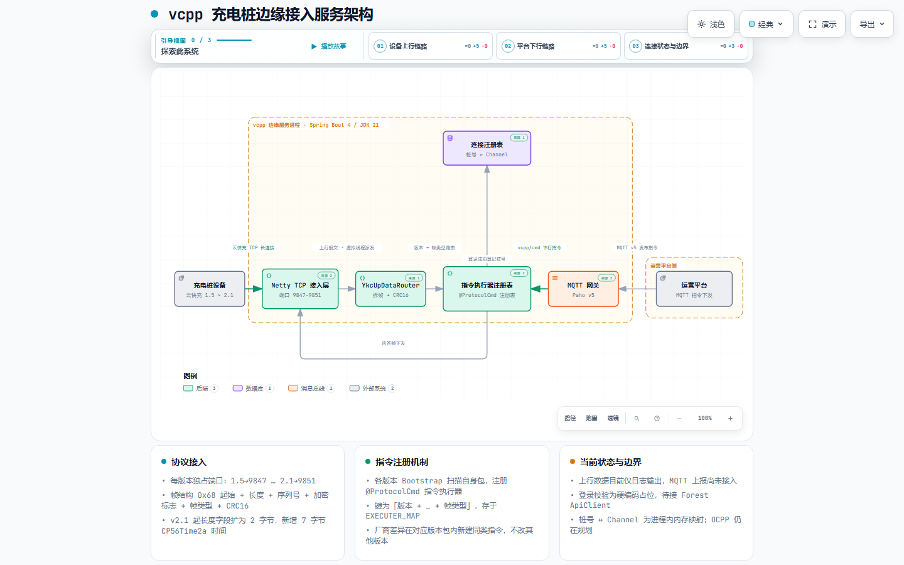

# vcpp

充电桩边缘设备服务（平台侧），接收充电桩 TCP 长连接并完成国产云快充协议的编解码。

## 支持范围

- [ ] 云快充 1.5 ~ 2.x
- [ ] OCPP 1.6 ~ 2.x

## 架构

## 端口

Web 服务端口：`10086`

TCP 服务端口（每个协议版本独立端口）：

| 协议版本   | 端口 | 说明   |
|------------|------|--------|
| 云快充 1.4 | —    | 已淘汰 |
| 云快充 1.5 | 9847 |        |
| 云快充 1.6 | 9848 |        |
| 云快充 1.7 | 9849 |        |
| 云快充 1.8 | 9850 |        |
| 云快充 2.1 | 9851 |        |

## 桩号

云快充：14 位长整数。

## 价格模型

- `BillingSection`：有序集合（尖峰平谷 或 自由定价 顺序）
- `BillingModel`：48 时段对应电价，起止时间 + `BillingSection` 集合对应索引

## 兼容性处理

> 不同厂商主板不一定严格按照标准协议实现，不兼容的地方额外定义 `ProtocolCmd.protocols` 单独处理。

## 报文 demo

[云快充](doc/云快充/)
